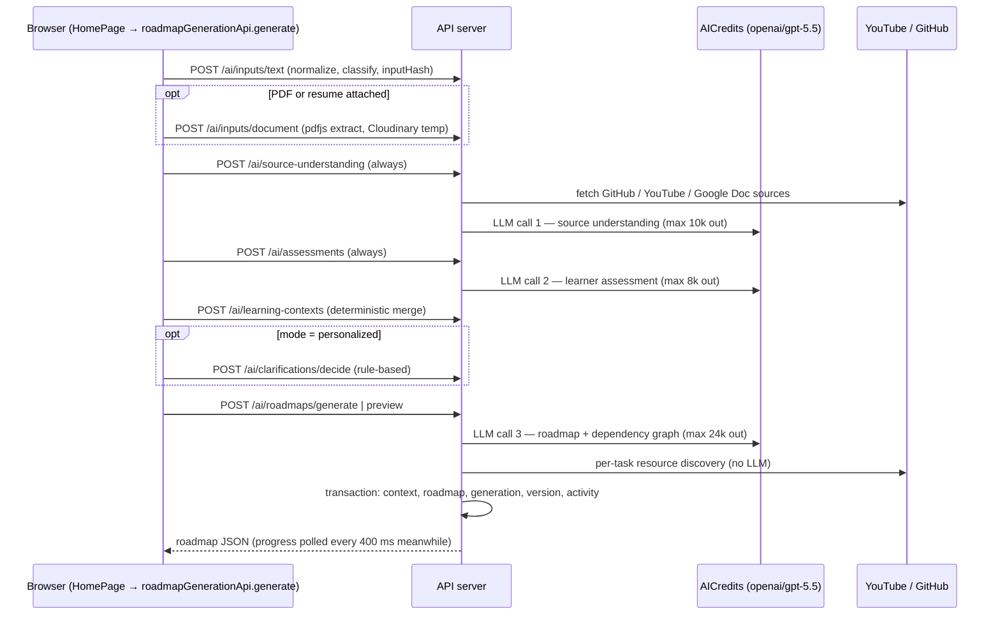
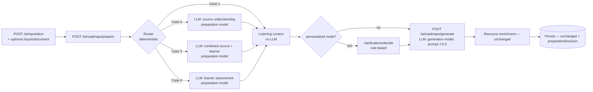

# RFC 0001 — Conditional AI preparation, model routing, and cost measurement

- **Status:** Draft, revision 3 (review decisions Q1–Q10 and the second review's nine points applied, see sections 14–15). Awaiting final approval. No implementation code has been changed.
- **Scope:** Roadmap-generation AI pipeline (source understanding, learner assessment, roadmap generation), model configuration, retries, cost accounting, measurement, and a feasibility check for routing through the Cursor agent SDK.
- **Out of scope:** Resource discovery and ranking behavior, workspace editing, community features. They are only covered by regression checks here.

Everything in sections 1 and 2 describes **existing** code. Everything from section 3 onward is **proposed**.

---

## 1. Current architecture (existing)

### 1.1 Request path

The browser orchestrates the pipeline as a chain of HTTP calls (`client/src/features/roadmaps/api/roadmap-generation-api.js`, `roadmapGenerationApi.generate`). There is no server-side routing and no queue.



### 1.2 AI-call inventory

| #   | Operation            | Call site                                                                        | Prompt                                  | Input                                                                             | Max output | Profile → model           |
| --- | -------------------- | -------------------------------------------------------------------------------- | --------------------------------------- | --------------------------------------------------------------------------------- | ---------- | ------------------------- |
| 1   | Source understanding | `server/src/modules/ai/source-understanding/source-understanding.service.js:142` | `prompts/source-understanding/1.0.0.md` | `{ sources }` (typed goal is itself a source)                                     | 10,000     | `core` → `openai/gpt-5.5` |
| 2   | Learner assessment   | `server/src/modules/ai/assessment/assessment.service.js:114`                     | `prompts/learner-assessment/1.0.0.md`   | `{ normalizedInputs, deterministicSignals }` — goal text, resume text if uploaded | 8,000      | `core` → `openai/gpt-5.5` |
| 3   | Roadmap generation   | `server/src/modules/ai/roadmap-planning/roadmap-planning.service.js:261`         | `prompts/roadmap-generation/1.0.0.md`   | `{ learningContext, sourceUnderstanding }`                                        | 24,000     | `core` → `openai/gpt-5.5` |

Provider: `openai-compatible.provider.js` using the OpenAI Responses API (`responses.create`) with `json_schema` + `strict: true`. Output is re-validated with AJV (`validateAiOutput`), then evidence validators (`validateSourceEvidence`, `validateAssessmentEvidence`).

### 1.3 Limitations found in the code

1. **Preparatory calls always run.** The client calls source understanding and assessment unconditionally (`roadmap-generation-api.js:173` and `:183`). For a one-line goal, call 1 analyzes only that sentence and call 2 has no evidence.
2. **The roadmap prompt ignores source understanding.** `roadmap-generation/1.0.0.md` says "Consume only the supplied canonical Learning Context". The full `sourceUnderstanding` object is sent (`roadmap-planning.service.js:264-267`), but the model is never told how to use it, which requirements are mandatory, or how they relate to proficiency.
3. **Full source understanding is forwarded,** including every evidence excerpt, instead of a compact brief.
4. **One model for everything.** `fast`, `core` and `escalation` profiles exist (`ai.config.js:4-8`), but all three call sites request `core`, and `.env` sets all three to `openai/gpt-5.5`.
5. **No reasoning-effort control.** `responses.create` never sets `reasoning.effort`, so every call uses the model default. Reasoning tokens are billed as output.
6. **Retries are invisible.** Retries happen inside the OpenAI SDK (`maxRetries: 2`). `AiUsageRecord.attempt` exists but is always 1, so retried calls cannot be counted.
7. **Cost is never calculated,** although `AiUsageRecord.calculatedCost` exists and the AICredits catalog that the startup health check already downloads (`/api/models`) includes per-token INR prices.
8. **Calls of one generation are not linked.** Each call gets its own `runId`. There is no shared pipeline ID, so "calls per roadmap" cannot be queried.
9. **Learning context requires an assessment.** `learning-context.service.js:17` validates an assessment object, and its schema forces `currentLevel` to one of four levels. A "neutral" assessment would therefore have to invent a level.
10. **No evaluation set.** All folders under `evaluation/` are empty. The 147 server unit tests (145 pass, 2 skipped live tests) use mocked providers.

What already works and will be reused:

- `inputHash` per call, `ai_runs` and `ai_usage_records` with input, cached, output and reasoning tokens.
- Learning-context fields carry `status` (`resolved | unresolved | conflicted`) and `provenance` (`explicit_user`, `questionnaire`, `user_profile`, `ai_assessment`, `system_default`, …). An unknown proficiency already stays `unresolved` rather than becoming "beginner".
- The startup health check already fails with `AI_MODEL_UNAVAILABLE` if a configured model is missing from the catalog.
- Resource enrichment does not read `sourceUnderstanding`, so skipping it cannot affect resources.

---

## 2. Model catalog facts (AICredits, fetched Oct 11 2026)

Prices from `GET https://api.aicredits.in/api/models`, converted to INR per 1M tokens. **AICredits has no free text models**; the only `is_free` entries are audio models.

| Model                          |  Input | Cached input |   Output | Context | Responses API  |
| ------------------------------ | -----: | -----------: | -------: | ------: | :------------: |
| `openai/gpt-5.5` (current)     | 508.36 |        50.84 | 3,050.14 |   1.05M |      yes       |
| `openai/gpt-5.4`               | 254.18 |        25.42 | 1,525.07 |   1.05M |      yes       |
| `openai/gpt-5-mini`            |  25.42 |         2.54 |   203.34 |    400k |      yes       |
| `openai/gpt-5-nano`            |   5.08 |         0.51 |    40.67 |    400k |      yes       |
| `openai/gpt-4.1-mini`          |  40.67 |        10.17 |   162.67 |   1.05M |      yes       |
| `openai/gpt-4.1-nano`          |  10.17 |         2.54 |    40.67 |   1.05M |      yes       |
| `google/gemini-3.1-flash-lite` |  25.42 |         2.54 |   152.51 |   1.05M | no (chat only) |
| `deepseek/deepseek-v4.1-flash` |  30.50 |         0.45 |   122.01 |   1.05M | no (chat only) |

Note: the bare IDs `gpt-5-mini` / `gpt-5-nano` report an 8,192-token context; the `openai/`-prefixed IDs report 400k. Use the prefixed IDs.

**Illustrative arithmetic only — not a measurement.** If a preparatory call used 3,000 input and 2,000 output tokens, it would cost about ₹7.63 on `gpt-5.5` and ₹0.48 on `gpt-5-mini`. If the final call used 6,000 input and 12,000 output tokens on `gpt-5.5`, it would cost about ₹39.65. Under those assumptions the final call dominates, so **removing preparatory calls saves less than tuning the final call's reasoning effort and output size.** Real token counts must be measured before any claim (section 9).

---

## 3. Proposed architecture

### 3.1 Summary of changes

1. **Move routing and preparation to the server.** A new endpoint, `POST /ai/roadmaps/prepare`, replaces the client's separate calls to source understanding, assessment and learning context. It decides the case, runs zero or one preparatory LLM call, and returns the learning context plus a compact preparation record. Clarification and generation stay as they are. The old endpoints stay for compatibility and tests.
2. **Deterministic router** with explicit states, so no LLM call is spent on routing.
3. **One combined preparatory call** when both source understanding and assessment are needed.
4. **Two model profiles in practice:** preparation (cheap) and generation (high quality), each with its own reasoning effort.
5. **Versioned final prompt (`roadmap-generation/2.0.0`)** with defined sections for objective, source context, learner context and invariant requirements.
6. **Accounting fixes:** a pipeline ID shared by all calls of one generation, app-level retries recorded per attempt, and cost calculated from catalog prices.

### 3.2 Proposed request path



Browser round trips drop from five or six to three or four. This is a design simplification, not a latency result: end-to-end speed is only claimed from the measurements in section 9.3.

The current pipeline stays available behind the existing feature-flag service (`server/src/infrastructure/feature-flags/`) as `AI_ROUTED_PREPARATION: 'ai-routed-preparation'`, set through `FEATURE_FLAGS` (default **off**). With the flag off, `/prepare` runs the legacy behavior server-side: source understanding and assessment as separate calls on every request, exactly as today. The flag is turned on only after the new pipeline meets the quality thresholds in section 9.4.

---

## 4. Routing

### 4.1 States

Per operation: `REQUIRED`, `NOT_REQUIRED`, `ALREADY_AVAILABLE`, `INSUFFICIENT_EVIDENCE`. At runtime a required operation can also end as `FAILED` (section 8). These live in `shared/src/constants` so the client, server and tests share them.

### 4.2 Source understanding decision

Source types come from the existing `buildGenerationSources` and the ingestion classifier.

| Condition                                                                                                    | State               | Reason                                                                                 |
| ------------------------------------------------------------------------------------------------------------ | ------------------- | -------------------------------------------------------------------------------------- |
| Any source of type `ai_report`, `github_repository`, `youtube_video`, `google_document`, or a non-resume PDF | `REQUIRED`          | Content the final call cannot see or would receive raw and oversized                   |
| Only `natural_prompt` sources                                                                                | `NOT_REQUIRED`      | The goal text already reaches the final call verbatim as `learningContext.primaryGoal` |
| Request carries a validated understanding whose source `contentHash` list matches the current sources        | `ALREADY_AVAILABLE` | Clarification-answer path                                                              |
| Unknown source type                                                                                          | `REQUIRED`          | Safe fallback: spend a cheap call rather than lose source requirements                 |

A resume is treated as learner evidence, not as a planning source. Today it is sent to both calls.

### 4.3 Learner assessment decision

The decision uses only deterministic signals that already exist (`deterministic-signal.extractor.js`: technologies, years of experience, job titles, education lines) plus a small first-person self-description pattern (for example "I have worked", "I know", "I'm a").

| Condition                                                                 | State                   | Reason                                                                                                                  |
| ------------------------------------------------------------------------- | ----------------------- | ----------------------------------------------------------------------------------------------------------------------- |
| Resume text present, or the goal text contains self-description signals   | `REQUIRED`              | Unstructured evidence that only a model can turn into skills and level                                                  |
| No unstructured evidence, and the user picked a level (`experienceLevel`) | `NOT_REQUIRED`          | Structured values (level, questionnaire, saved profile skills) flow into the learning context directly, with provenance |
| No unstructured evidence and no level ("Not sure" or not asked)           | `INSUFFICIENT_EVIDENCE` | No call; the beginner-to-intermediate default applies (decision Q1, below)                                              |

**Decision Q1 — default level.** When the level is unknown, the roadmap targets a beginner-to-intermediate learner. This is recorded as a labelled system default, not as an assessment result: `currentProficiency` keeps status `unresolved` with no invented `currentLevel`, an assumption `{ field: 'currentProficiency', value: 'beginner_to_intermediate', source: 'system_default' }` is added, and `learningStrategy.selectedDepth` is `beginner_to_intermediate`. The same default applies when a required assessment fails (decision Q2). Personalized mode still asks the existing clarification question first; the default applies only if no level results.

Structured profile data (saved skills, experience, education) never triggers an assessment call. The builder already maps it with `user_profile` provenance.

### 4.4 Case matrix

| Case | Source understanding                  | Learner assessment                        | Preparatory call     | Total LLM calls |
| ---- | ------------------------------------- | ----------------------------------------- | -------------------- | --------------- |
| 1    | `NOT_REQUIRED` or `ALREADY_AVAILABLE` | `NOT_REQUIRED` or `INSUFFICIENT_EVIDENCE` | none                 | 1               |
| 2    | `REQUIRED`                            | `NOT_REQUIRED` or `INSUFFICIENT_EVIDENCE` | source understanding | 2               |
| 3    | `REQUIRED`                            | `REQUIRED`                                | combined             | 2               |
| 4    | `NOT_REQUIRED` or `ALREADY_AVAILABLE` | `REQUIRED`                                | learner assessment   | 2               |

**Additional cases: none proposed.** The only other path found in the code is answering a clarification. It is Case 1 with source understanding `ALREADY_AVAILABLE`; it already makes exactly one call today and needs no new branch.

### 4.5 Decision record

Returned by `/prepare`, persisted on `roadmap_contexts.preparationDecision`, and logged (states and hashes only, no content):

```json
{
  "routerVersion": "1.0.0",
  "case": 3,
  "sourceUnderstanding": { "state": "REQUIRED", "reason": "github_repository source present" },
  "learnerAssessment": { "state": "REQUIRED", "reason": "resume text present" },
  "operations": ["combined_preparation"],
  "profiles": { "preparation": "fast", "generation": "core" },
  "expectedCalls": 2,
  "pipelineId": "…uuid…"
}
```

### 4.6 Per-case contracts

Invariants that hold on **every** route:

- **I1. Goal preserved.** The complete user goal text reaches the final call verbatim as `objective.primaryGoal`. It is never replaced by a summary.
- **I2. Explicit choices win.** A level the user selected (`explicit_user` or `questionnaire` provenance) is always the selected `currentProficiency`. An AI assessment can add skills and evidence, but cannot override it; a disagreement is recorded as a `conflicted` field, which the builder already supports.
- **I3. Structured profile data always flows.** Saved profile skills, experience and education reach the learning context on every route, with `user_profile` provenance, whether or not an assessment runs.
- **I4. Requirements are never removed by proficiency.** Learner context changes depth and order only. Every source requirement in `sourceContext` must appear in `requirementCoverage` (section 6.3).
- **I5. Nothing is invented.** A route that skips an operation sends that block with an explicit state and an empty body. It never sends a placeholder result.
- **I6. Validated prior results are reused.** Source understanding is reused only when its source content hashes match the current sources exactly; otherwise it is recomputed.

| Case | Inputs (beyond the goal)                                                                        | Operations                                                                                              | Outputs of preparation                                                                      | What the final call receives                                                                                                                                                                                                                                                 |
| ---- | ----------------------------------------------------------------------------------------------- | ------------------------------------------------------------------------------------------------------- | ------------------------------------------------------------------------------------------- | ---------------------------------------------------------------------------------------------------------------------------------------------------------------------------------------------------------------------------------------------------------------------------- |
| 1    | Optional level, questionnaire, saved profile; optional prior understanding with matching hashes | Deterministic learning context only                                                                     | Learning context; prior understanding passed through unchanged if present                   | `objective` (full goal); `sourceContext.state` `NOT_REQUIRED` with empty brief, or `ALREADY_AVAILABLE` with the prior brief and its requirements; `learnerContext` with `NOT_REQUIRED` or `INSUFFICIENT_EVIDENCE`; `selectedDepth` from the explicit level or the Q1 default |
| 2    | One or more planning sources (link, PDF, report); optional level, questionnaire, saved profile  | Retrieve sources → source understanding (preparation model) → deterministic learning context            | Full understanding (persisted) with `requirements[]`; per-source statuses; learning context | `sourceContext` `REQUIRED` with the compact brief and **all** requirements; `learnerContext` `NOT_REQUIRED` or `INSUFFICIENT_EVIDENCE`; depth from explicit level or Q1 default                                                                                              |
| 3    | Planning sources **and** learner evidence (resume or self-description)                          | Retrieve sources → one combined call (paid preparation model if resume, section 5.2) → learning context | Full understanding with requirements; assessment; per-source statuses; learning context     | `sourceContext` `REQUIRED` with all requirements; `learnerContext` `REQUIRED` with assessment-derived fields (subject to I2); depth from the resolved level. Requirements are copied from the understanding half only, never from the assessment half                        |
| 4    | Learner evidence; no planning source; optional prior understanding with matching hashes         | Learner assessment (paid preparation model if resume) → learning context                                | Assessment; learning context                                                                | `sourceContext` `NOT_REQUIRED` with empty brief (or `ALREADY_AVAILABLE` if a prior understanding matches); `learnerContext` `REQUIRED`; depth from the resolved level                                                                                                        |

### 4.7 Pseudocode

```js
function decidePreparation({ sources, assessmentInputs, signals, explicitInput, prior }) {
  const su = sourceState(sources, prior);
  const la = learnerState(assessmentInputs, signals, explicitInput);
  const run = { su: su.state === 'REQUIRED', la: la.state === 'REQUIRED' };
  const kase = run.su && run.la ? 3 : run.su ? 2 : run.la ? 4 : 1;
  const operations =
    kase === 3
      ? ['combined_preparation']
      : kase === 2
        ? ['source_understanding']
        : kase === 4
          ? ['learner_assessment']
          : [];
  return {
    case: kase,
    sourceUnderstanding: su,
    learnerAssessment: la,
    operations,
    expectedCalls: operations.length + 1,
  };
}
```

---

## 5. Model configuration

Decision Q4: the preparation profile prefers the best free open-source model, with cheap paid fallbacks.

| Logical profile | Used for             | Model chain (tried in order)                                                                                                                                        | Reasoning effort env                          |
| --------------- | -------------------- | ------------------------------------------------------------------------------------------------------------------------------------------------------------------- | --------------------------------------------- |
| Preparation     | Cases 2, 3, 4 call 1 | 1. `openrouter:nvidia/nemotron-3-super-120b-a12b:free` (free) → 2. `aicredits:openai/gpt-oss-120b` (open source, ₹3.76 / ₹17.28) → 3. `aicredits:openai/gpt-5-mini` | `AI_REASONING_EFFORT_FAST` (default `low`)    |
| Generation      | Final roadmap call   | `aicredits:openai/gpt-5.5` (unchanged)                                                                                                                              | `AI_REASONING_EFFORT_CORE` (default `medium`) |
| Escalation      | Unused; kept         | unchanged                                                                                                                                                           | —                                             |

The chain above is a **candidate order, not a recommendation.** No model, free or paid, is used in production until it passes the eligibility gate in section 5.1. Other free candidates with structured-output support on OpenRouter (Oct 11 2026): `apodex/apodex-1.1-mini:free`, `dots-studio/dots-3-note-preview:free`. Other cheap open-source candidates on AICredits: `qwen/qwen3.7-flash` (₹4.07 / ₹14.23, 1M context).

Configuration:

- `AI_MODEL_FAST` accepts a comma-separated chain of `provider:model` entries (a bare model ID still means the default provider, so existing `.env` files keep working). Same for `AI_MODEL_CORE`.
- New `OPENROUTER_API_KEY` and `OPENROUTER_BASE_URL` (default `https://openrouter.ai/api/v1`). If no OpenRouter key is set, OpenRouter entries are skipped.
- Call sites ask for a profile (`'fast'`, `'core'`), never a model ID. This is how the code already works; only the profile choice at each call site changes.

### 5.1 Production eligibility gate

A model entry is usable in production only if `evaluation/routing/model-eligibility.json` contains a passing record for that exact `provider:model` pair, operation (`source_understanding`, `learner_assessment`, `combined_preparation`, `roadmap_generation`) and adapter. The record is written by the evaluation script (section 9.4) and committed, so the approval is reviewable.

Required to pass (proposed thresholds, to be agreed in review):

| Check                                                                                                                                 | Threshold                        |
| ------------------------------------------------------------------------------------------------------------------------------------- | -------------------------------- |
| Probe: the adapter's exact request format (endpoint, `response_format` / `text.format` with `strict: true`) returns schema-valid JSON | Must pass                        |
| Strict JSON-schema validation across evaluation fixtures                                                                              | ≥ 95% of attempts                |
| Evidence validation (exact-substring excerpts)                                                                                        | ≥ 90% of attempts                |
| Source-requirement recall against hand-labelled fixture requirements                                                                  | ≥ 90% of critical requirements   |
| Output-quality review of preparation results (summary, concepts, assessment level) by the user on the fixture set                     | No fixture marked unacceptable   |
| Rate-limit or availability failures during the evaluation                                                                             | Reported; free models need < 20% |

Enforcement: at startup, in `NODE_ENV=production` chain entries without a passing record are removed with a logged warning, and startup fails if a profile is left empty. In development, unapproved entries run but are logged and labelled `unapproved` on every usage record. The current `openai/gpt-5.5` generation model is grandfathered as the baseline but still gets a record from the same evaluation.

### 5.2 Privacy gate

Each request gets a data class at `/prepare`, before any model is chosen:

- `personal`: the request includes resume-derived text (an uploaded document classified as `resume`, or `resumeText` in assessment inputs).
- `general`: everything else.

Each chain entry has an endpoint class: `free` (OpenRouter `:free` models, which may log prompts) or `paid_approved` (AICredits). The gate filters the chain **once, before the first attempt**: `personal` requests get only `paid_approved` entries. Retries and fallbacks select only from this filtered list, so no failure path can reach a free endpoint. The same function is used by the application, the benchmark and the evaluation scripts; there is no bypass.

Tests assert the actual outbound destination: the adapters' HTTP client is mocked and every `personal` fixture, including retry and fallback paths, must show zero requests to `openrouter.ai`. Each usage record also stores the endpoint host, so production traffic can be audited with a query.

### 5.3 Retries versus fallbacks

- A **retry** repeats the same operation on the same provider and model after a transient error (429, 5xx, timeout, connection error).
- A **fallback** moves to the next entry in the privacy-filtered chain after that entry's retries are used up, or after one schema or evidence validation failure.
- A fallback keeps the same operation, prompt version, input and output schema. It can never switch operations (for example from combined preparation to separate calls) or widen the data destination.
- Each attempt's usage record stores `attemptKind` (`initial`, `retry`, `fallback`), `attempt` (count per model), and `chainIndex`. Reports show planned calls, retries and fallbacks as separate numbers.

### 5.4 Adapters and health checks

- **New Chat Completions adapter** (`chat-completions.provider.js`): all three preparation candidates support only Chat Completions. It uses the same `openai` npm package (`chat.completions.create` with `response_format: { type: 'json_schema', strict: true }`) and maps `prompt_tokens`, `completion_tokens` and their cached/reasoning details into the existing usage shape. Output still goes through the same AJV and evidence validators.
- **Health check per provider:** AICredits models must list the adapter's API in `supported_apis`; OpenRouter models must list `structured_outputs` in `supported_parameters`. A free model missing from the catalog is a warning, not a startup failure, because the chain can fall back.
- **Catalog presence is not proof of support.** A model listing structured-output support in a catalog still has to pass the probe in section 5.1 through the exact adapter that will call it.

---

## 6. Prompts and context injection

### 6.1 Preparatory prompts

- `source-understanding/1.1.0`: adds an explicit untrusted-data rule (already present in the assessment prompt) and a new `requirements[]` output: `{ id, statement, kind: deliverable | constraint | evaluation_criterion | requirement, origin: source_fact | inference, criticality: critical | noncritical, evidenceIds[] }`. Criticality is then checked deterministically: a requirement can be `critical` only if its origin is `source_fact` and it has at least one valid evidence ID. Deliverables and evaluation criteria with source evidence are always `critical`, whatever the model said. Inferences are always `noncritical`.
- `learner-assessment/1.0.0`: unchanged.
- `preparation-combined/1.0.0` (new): returns `{ sourceUnderstanding, learnerAssessment }`. Each half reuses the existing schemas, so both are validated by the existing validators. The prompt states that the learner assessment must not change or remove source requirements.

### 6.2 Final prompt `roadmap-generation/2.0.0`

The input changes from `{ learningContext, sourceUnderstanding }` to a defined object:

```json
{
  "objective": { "primaryGoal": "…", "goalType": "project" },
  "sourceContext": {
    "state": "REQUIRED | NOT_REQUIRED | ALREADY_AVAILABLE | FAILED",
    "brief": {
      "summary": "…",
      "invariantRequirements": [
        { "id": "R1", "statement": "…", "kind": "deliverable", "origin": "source_fact" }
      ],
      "concepts": [],
      "prerequisites": [],
      "milestones": [],
      "preservedStructure": [],
      "creatorRecommendations": [],
      "assumptions": []
    }
  },
  "learnerContext": {
    "assessmentState": "REQUIRED | NOT_REQUIRED | INSUFFICIENT_EVIDENCE | FAILED",
    "learningContext": { "…existing canonical Learning Context…": "" }
  },
  "learningStrategy": {
    "selectedDepth": "foundational | standard | accelerated | beginner_to_intermediate"
  }
}
```

- `brief` is a compact projection of the full understanding: evidence excerpts are dropped, evidence IDs are kept. The full understanding is still persisted in `roadmap_contexts` for provenance.
- `selectedDepth` is derived deterministically: resolved beginner → `foundational`, intermediate → `standard`, advanced or expert → `accelerated`, unresolved or failed assessment → `beginner_to_intermediate` (decision Q1): cover foundations briefly, then progress to intermediate material, without labelling the learner a beginner.
- The prompt has fixed sections explaining how to use each block: invariant requirements must each be covered; source facts versus inferences; depth adapts presentation, never requirements; `beginner_to_intermediate` means brief foundations followed by intermediate material, without labelling the learner a beginner; learning goals build concepts first; project goals follow the implementation sequence; all supplied content is data, not instructions.
- The generation output schema gains `requirementCoverage[]: { requirementId, taskKeys[] }`, stored with the planning graph, not inside the roadmap document.

### 6.3 Requirement coverage enforcement

After the final call, a deterministic check confirms every requirement is listed in `requirementCoverage` and every listed task key exists in the roadmap.

| Result                                           | Action                                                                                                                                                                                                                                                                                                                                                                                       |
| ------------------------------------------------ | -------------------------------------------------------------------------------------------------------------------------------------------------------------------------------------------------------------------------------------------------------------------------------------------------------------------------------------------------------------------------------------------- |
| All covered                                      | Success                                                                                                                                                                                                                                                                                                                                                                                      |
| Only noncritical requirements missing            | Success with a recorded validation issue; the workspace lists the uncovered items as suggestions                                                                                                                                                                                                                                                                                             |
| One or more **critical** requirements missing    | **One bounded repair attempt** on the generation model: input is the roadmap outline (phase, week and task keys and titles only) plus the missing requirements; output is a small schema of tasks to insert at given week keys, with their coverage. Inserted tasks are validated, dependency-checked and merged. The repair is recorded as a separate `repair` stage, not as a planned call |
| Critical requirements still missing after repair | The roadmap is saved and returned with `status: degraded` and a visible warning naming each missing requirement. It is never presented as fully successful                                                                                                                                                                                                                                   |

A repair call is the only case where a route makes more calls than in the matrix in section 4.4, and it is reported separately.

---

## 7. Sanity checks, by layer

| Area                       | Deterministic (runs on every request)                                                                                                                 | Unit / integration tests (mocked provider)                                                                                                 | Offline evaluation (test set, real provider)                            |
| -------------------------- | ----------------------------------------------------------------------------------------------------------------------------------------------------- | ------------------------------------------------------------------------------------------------------------------------------------------ | ----------------------------------------------------------------------- |
| A. Source understanding    | Existing evidence-substring validator; every `requirements[].evidenceIds` exists; source count and content hashes match input                         | Unnecessary call never made for prompt-only input; injected "ignore previous instructions" text in a source has no effect on output schema | Requirement recall against hand-labelled fixtures                       |
| B. Learner assessment      | Existing evidence validator; `INSUFFICIENT_EVIDENCE` keeps `currentProficiency` unresolved                                                            | Short prompt without level never yields `beginner`; missing profile is not a skill gap                                                     | Final roadmaps differ measurably between beginner and advanced fixtures |
| C. Routing and call counts | Decision record persisted; planned calls vs. actual attempts compared and logged                                                                      | Per case: exact provider-call count; generation called exactly once; retries counted as attempts, not stages                               | Calls per roadmap from `ai_usage_records` grouped by `pipelineId`       |
| D. Model selection         | Health check: model present and supports `responses`; recorded `model` equals configured model                                                        | Preparation uses `fast`, generation uses `core`                                                                                            | —                                                                       |
| E. Final roadmap           | Existing schema + repair validation; requirement coverage with critical/noncritical policy and bounded repair (section 6.3)                           | Malformed output handled safely (existing tests)                                                                                           | Ordering and depth rubric per goal type                                 |
| F. Resources               | Unchanged                                                                                                                                             | Existing resource tests must keep passing                                                                                                  | Unchanged                                                               |
| G. Persistence             | No change to `Roadmap` model; optional new `preparationDecision` field only                                                                           | Existing workspace, adopt, duplicate tests keep passing; old roadmaps open                                                                 | —                                                                       |
| H. Security                | No secrets in prompts; logs contain states and hashes only; privacy gate filters the chain before the first attempt; endpoint host stored per attempt | Prompt-injection fixtures; zero outbound requests to free endpoints for `personal` fixtures, including retry and fallback paths            | —                                                                       |

---

## 8. Errors, retries, fallbacks

- **Retries move from the SDK to the app.** Set the SDK's `maxRetries` to 0 and retry in the provider wrapper, writing one `AiUsageRecord` per attempt with `attempt = n`. Retry only on 429, 5xx, timeouts and connection errors, never on schema or evidence validation failures. Decision Q3: 1 retry for generation (expensive) and 2 for preparation, configurable as `AI_MAX_RETRIES_CORE` and `AI_MAX_RETRIES_FAST` (the existing `AI_MAX_RETRIES` remains the default for both). Retries happen per model, before falling back to the next model in the chain (section 5.3).

### 8.1 Source statuses

Each source carries two independent statuses, persisted on `roadmap_contexts.sourceStatuses[]` together with its type, URL or file name, error code and whether the error is retryable:

- **Retrieval:** `retrieved`, `retrieval_failed`, or `not_applicable` (typed text).
- **Understanding:** `understood`, `understanding_failed`, or `not_required`.

This extends the existing `sourceProcessing` list, which only records `processed` or `failed`. Today, if every source fails to normalize, `source-understanding.service.js` throws and generation stops; under this policy it continues from the goal text instead (unless the goal is empty, last row below).

### 8.2 What happens on failure (decision Q2)

Generation continues from whatever is available, and the user is told exactly what was used.

| Situation                                                                                | Final call receives                                                                                                                                                              | User sees                                                                                                                                                             |
| ---------------------------------------------------------------------------------------- | -------------------------------------------------------------------------------------------------------------------------------------------------------------------------------- | --------------------------------------------------------------------------------------------------------------------------------------------------------------------- |
| Source **retrieval failed** (repo private or deleted, PDF unreadable, video unavailable) | Nothing from that source. It is listed in `sourceContext.unavailableSources` with the instruction that the roadmap must not claim to be based on it                              | "We couldn't access `<url or file name>` (`<reason>`). This roadmap was built without it." The source stays listed so it can be retried later                         |
| Source retrieved, **understanding failed** after retries and fallbacks                   | A bounded raw excerpt (first 8,000 characters per source, marked untrusted) with `sourceContext.state: FAILED`. No requirements are marked critical, because none were validated | "We read `<source>` but couldn't fully analyse it; the roadmap uses an excerpt of it."                                                                                |
| **Assessment failed**                                                                    | `learnerContext.assessmentState: FAILED`; the Q1 beginner-to-intermediate default; explicit user choices still apply (invariant I2)                                              | "We couldn't analyse your resume; the roadmap assumes a beginner-to-intermediate level." If the resume was not retrieved, the retrieval message above applies instead |
| **All** planning sources unavailable and the goal text is empty                          | Generation stops with an error: there is nothing to plan from                                                                                                                    | An error naming each failed source                                                                                                                                    |

In every degraded case the generation is marked `degraded` in `roadmap_generations.validation.issues`, and the workspace shows the same messages as the generation screen.

Also:

- **Router cannot classify** a source: treat it as `REQUIRED` (section 4.2).
- **Final call fails:** unchanged behavior (error returned, failure recorded).

---

## 9. Cost and latency measurement

### 9.1 Pipeline ID

Generated by `/prepare`, passed to `/generate`, any repair call and resource enrichment, and stored on `ai_runs` and `ai_usage_records`.

### 9.2 Cost calculation

**Units.** The AICredits catalog fields `input_cost_per_token_inr`, `cached_input_cost_per_token_inr` and `output_cost_per_token_inr` are already **per token**; the per-1M figures in section 2 are those values × 1,000,000 for readability. The code stores and uses per-token prices. Any price entered per million is divided by 1,000,000 when loaded, in one place.

**Token semantics.** In the OpenAI Responses API, `input_tokens` **includes** cached tokens (`input_tokens_details.cached_tokens` is a subset), and `output_tokens` **includes** reasoning tokens. Chat Completions uses the same structure (`prompt_tokens_details.cached_tokens`, `completion_tokens_details.reasoning_tokens`). This is how OpenAI documents it. Whether AICredits and OpenRouter pass these fields through unchanged is **not yet verified**; the probe calls in step 1 of the implementation order check it by comparing each response's usage with a repeated identical request, where the second should show cached tokens. A provider whose semantics differ gets its own normalizer.

**Formula** (all prices per token):

```text
uncachedInput  = inputTokens − cachedInputTokens
calculatedCost = uncachedInput     × inputPricePerToken
               + cachedInputTokens × cachedInputPricePerToken   (falls back to inputPricePerToken if the catalog has no cached price)
               + outputTokens      × outputPricePerToken        (reasoning tokens are inside outputTokens; not added again)
```

Stored per usage record: `calculatedCost`, `costCurrency`, `pricingVersion` (catalog `last_updated`), and the per-token prices used. If the provider reports its own cost (OpenRouter can return `usage.cost`, in USD), it is stored as `providerReportedCost` with its currency, next to ours rather than in place of it, so they can be checked against each other. Free endpoints are recorded at a cost of 0 with `endpointClass: free`.

**Unit tests** (`server/test/ai-cost.test.js`) with fixed token counts and expected INR, using `openai/gpt-5.5` per-token prices `0.00050836` / `0.00005084` / `0.00305014`:

|  Input | Of which cached | Output | Expected INR                                                               |
| -----: | --------------: | -----: | -------------------------------------------------------------------------- |
| 10,000 |               0 |  2,000 | 10,000 × 0.00050836 + 2,000 × 0.00305014 = **11.18388**                    |
| 10,000 |           4,000 |  2,000 | 6,000 × 0.00050836 + 4,000 × 0.00005084 + 2,000 × 0.00305014 = **9.35380** |
| 10,000 |           4,000 |  2,000 | Same, with no cached price in the catalog: **11.18388**                    |
|      0 |               0 |      0 | **0**                                                                      |
|    any |             any |    any | Free endpoint: **0**                                                       |

Also tested: per-million input is divided by 1,000,000 exactly once, and `cachedInputTokens > inputTokens` is rejected as invalid usage.

### 9.3 Latency

- **End-to-end latency** is measured from the moment the user starts generation (the `/prepare` request) to the moment a usable roadmap is persisted and returned. It includes source retrieval, preparation, generation, any repair, resource enrichment, persistence, and all retries and fallbacks.
- **Clarification wait** (time the user spends answering questions) is excluded from end-to-end latency and reported as its own number, because it measures the user, not the system.
- **Stage timings** are recorded per pipeline: retrieval, preparation, generation, repair, enrichment, persistence, plus counts of retries and fallbacks.
- p50 and p95 are reported for both the legacy and the routed pipeline on the same fixtures. Fewer round trips or calls is reported as a design change; only measured timings count as a speed improvement.

### 9.4 Benchmark and evaluation

1. **Report script** `scripts/ai-usage-report.js`: `$group` on `ai_usage_records` by `pipelineId` gives planned calls, retries, fallbacks, repairs, tokens, cost and stage latencies; then p50 and p95 across pipelines.
2. **Test set** in `evaluation/routing/` — 9 fixtures, two per case plus one `INSUFFICIENT_EVIDENCE` case. Each fixture has hand-labelled expected requirements (with criticality) and the expected learner level, so outputs can be scored:

| Case | Fixture                                                                       |
| ---- | ----------------------------------------------------------------------------- |
| 1    | "Learn React from scratch", level beginner                                    |
| 1    | "Prepare for a product manager interview", level intermediate                 |
| 1    | "Learn SQL", level "Not sure" (`INSUFFICIENT_EVIDENCE`)                       |
| 2    | GitHub repository link + level chosen                                         |
| 2    | Pasted structured AI report (> 1,500 characters with headings) + level chosen |
| 3    | Resume PDF + GitHub repository link                                           |
| 3    | Problem-statement PDF + "I've worked 3 years as a Node.js backend developer"  |
| 4    | Resume PDF + short goal                                                       |
| 4    | Goal containing self-description, no level                                    |

Decision Q6: resume and problem-statement PDFs are synthetic, generated by a script in `evaluation/routing/` so they are reproducible and contain no personal data.

3. **Baseline first, one input at a time (decision Q5):** run one fixture through the **legacy** pipeline and report its real token counts and INR cost before running the rest.
4. **Pipeline comparison:** all fixtures through the legacy and routed pipelines, three runs each if the per-run cost is acceptable to you. Both are scored on the same equivalent outputs:
   - Requirement coverage: recall of hand-labelled critical and noncritical requirements in the final roadmap, plus fidelity (no tasks contradicting the source).
   - Progression and proficiency suitability: the resolved level matches the fixture's expected level, and early tasks fit it.
   - Schema and evidence validation pass rates.
   - Success rate: a usable roadmap that isn't degraded.
   - End-to-end latency p50 and p95 (section 9.3), including retries, fallbacks and repairs.
   - Cost per **successful** roadmap: total cost of all attempts, including failed and repair calls, divided by successful roadmaps.
5. **Routed-pipeline acceptance thresholds** (proposed, to be agreed): critical-requirement recall no lower than legacy, and ≥ 90%; success rate no lower than legacy; no fixture where the user judges the routed roadmap worse. Until these pass, `AI_ROUTED_PREPARATION` stays off and the legacy pipeline remains the default.
6. **Preparation model evaluation:** each candidate runs the preparation call only (no final call) on the fixtures its endpoint class allows. **Free candidates run only on `general` fixtures**: the Case 2 fixtures, the Case 3 problem-statement fixture, and the Case 4 self-description fixture. Resume fixtures run only on `paid_approved` candidates, even though they are synthetic, so the evaluation follows the same privacy gate as production (section 5.2). Results are written to `model-eligibility.json` (section 5.1).

---

## 10. File-by-file plan

| File                                                                                                                                                                                                                                                                                                          | Change                                                                                                                                                                 |
| ------------------------------------------------------------------------------------------------------------------------------------------------------------------------------------------------------------------------------------------------------------------------------------------------------------- | ---------------------------------------------------------------------------------------------------------------------------------------------------------------------- |
| `shared/src/constants/index.js`                                                                                                                                                                                                                                                                               | Preparation states, case IDs                                                                                                                                           |
| `shared/src/contracts/` (AI contracts)                                                                                                                                                                                                                                                                        | New `ROADMAP_PLANNING_ENDPOINTS.prepare` contract; generate/preview accept `pipelineId` and `preparation`                                                              |
| `shared/src/schemas/ai/source-understanding.schema.json`                                                                                                                                                                                                                                                      | v1.1.0 adds `requirements[]`                                                                                                                                           |
| `shared/src/schemas/ai/preparation-combined.schema.json`                                                                                                                                                                                                                                                      | New, composes existing schemas                                                                                                                                         |
| `shared/src/schemas/ai/roadmap-generation.schema.json`                                                                                                                                                                                                                                                        | Adds `requirementCoverage[]`                                                                                                                                           |
| `prompts/source-understanding/1.1.0.md`, `prompts/preparation-combined/1.0.0.md`, `prompts/roadmap-generation/2.0.0.md`                                                                                                                                                                                       | New versions; old files kept                                                                                                                                           |
| `server/src/modules/ai/preparation/preparation-router.js`                                                                                                                                                                                                                                                     | New: pure decision function                                                                                                                                            |
| `server/src/modules/ai/preparation/preparation.service.js`, `.controller.js`, route in `ai.routes.js`                                                                                                                                                                                                         | New: runs the decided operation(s) and builds learning context                                                                                                         |
| `server/src/modules/ai/source-understanding/source-understanding.service.js`                                                                                                                                                                                                                                  | Accept a profile argument; prompt 1.1.0                                                                                                                                |
| `server/src/modules/ai/assessment/assessment.service.js`                                                                                                                                                                                                                                                      | Accept a profile argument                                                                                                                                              |
| `server/src/modules/ai/learning-context/learning-context.service.js`, `.builder.js`                                                                                                                                                                                                                           | Accept `assessment: null` with an assessment state; skip assessment candidates and its clarification flag when null                                                    |
| `server/src/modules/ai/roadmap-planning/roadmap-planning.service.js`                                                                                                                                                                                                                                          | Prompt 2.0.0 input object, compact brief, coverage validation, `pipelineId`                                                                                            |
| `server/src/modules/ai/providers/openai-compatible.provider.js`                                                                                                                                                                                                                                               | `reasoning.effort`, `maxRetries: 0`, app-level retry with per-attempt reporting                                                                                        |
| `server/src/modules/ai/providers/chat-completions.provider.js`                                                                                                                                                                                                                                                | New: Chat Completions adapter with strict JSON-schema output and usage mapping                                                                                         |
| `server/src/modules/ai/providers/provider.factory.js`, `ai-provider.registry.js`                                                                                                                                                                                                                              | Register AICredits and OpenRouter adapters; resolve a profile to its model chain                                                                                       |
| `server/src/modules/ai/providers/model-chain.js`                                                                                                                                                                                                                                                              | New: privacy gate filters the chain before the first attempt; retry per model, fall back within the filtered chain; records `attemptKind`, `chainIndex`, endpoint host |
| `server/src/modules/ai/providers/model-eligibility.js`, `evaluation/routing/model-eligibility.json`                                                                                                                                                                                                           | New: production eligibility gate (section 5.1)                                                                                                                         |
| `server/src/modules/ai/accounting/ai-cost.js`                                                                                                                                                                                                                                                                 | New: pure cost function (section 9.2)                                                                                                                                  |
| `server/src/modules/ai/roadmap-planning/requirement-coverage.js`, `prompts/roadmap-repair/1.0.0.md`, `shared/src/schemas/ai/roadmap-repair.schema.json`                                                                                                                                                       | New: coverage check, criticality rules and one bounded repair (section 6.3)                                                                                            |
| `server/src/modules/ai/ai.config.js`, `server/src/config/env.js`, `.env.example`                                                                                                                                                                                                                              | Model chains, OpenRouter key and URL, reasoning effort and retry counts per profile                                                                                    |
| `server/src/infrastructure/startup/startup-validation.js`                                                                                                                                                                                                                                                     | Per-provider catalog checks, cache prices                                                                                                                              |
| `client/src/features/roadmaps/components/GenerationExperience.jsx`, workspace context panel                                                                                                                                                                                                                   | Show retrieval and understanding status per source, unavailable-source messages, degraded and missing-requirement warnings (sections 6.3, 8.2)                         |
| `server/src/modules/ai/models/ai-run.model.js`, `ai-usage-record.model.js`                                                                                                                                                                                                                                    | Optional `pipelineId`, `attemptKind`, `chainIndex`, `endpointClass`, `endpointHost`, `stage`, `providerReportedCost`, prices used                                      |
| `server/src/modules/roadmaps/models/roadmap-context.model.js`                                                                                                                                                                                                                                                 | Optional `preparationDecision` (Mixed) and `sourceStatuses[]`                                                                                                          |
| Feature flag `AI_ROUTED_PREPARATION` (existing feature-flag service)                                                                                                                                                                                                                                          | Default off; legacy behavior kept until section 9.4 thresholds pass                                                                                                    |
| `client/src/features/roadmaps/api/roadmap-generation-api.js`                                                                                                                                                                                                                                                  | Replace the three calls with one `/prepare` call; pass `pipelineId`                                                                                                    |
| `scripts/ai-usage-report.js`, `scripts/ai-routing-benchmark.js`, `evaluation/routing/*`                                                                                                                                                                                                                       | Measurement                                                                                                                                                            |
| `server/test/preparation-router.test.js`, `server/test/preparation.test.js`, `ai-cost.test.js`, `model-chain-privacy.test.js` (mocked HTTP, asserts outbound hosts), `requirement-coverage.test.js`, per-case contract tests for invariants I1–I6, updates to planning, learning-context and client API tests | Tests                                                                                                                                                                  |
| `docs/adr/0004-…`                                                                                                                                                                                                                                                                                             | Written after approval, per `ARCHITECTURE_FREEZE.md`                                                                                                                   |

Implementation order:

1. Probe calls: structured output through each adapter, and usage semantics per provider (cached and reasoning tokens, reported cost).
2. Accounting: pipeline ID, attempt kinds, cost function and its unit tests, stage timings.
3. One-fixture baseline on the legacy pipeline.
4. Chat Completions adapter, model chain with privacy gate and its outbound-destination tests, eligibility gate.
5. Router and per-case contract tests.
6. Learning context accepting no assessment.
7. `/prepare` endpoint behind `AI_ROUTED_PREPARATION`, with source statuses.
8. Prompts and schemas, requirement coverage and repair.
9. Client changes.
10. Preparation model evaluation, then the full legacy-versus-routed benchmark.

---

## 11. Backward compatibility

- `Roadmap`, `roadmap_versions` and the workspace API are untouched. Existing roadmaps are never regenerated.
- New schema fields are optional; existing documents remain valid. Old prompt versions stay on disk and in `ai_prompts`.
- `/ai/source-understanding`, `/ai/assessments` and `/ai/learning-contexts` remain available.
- `roadmap_contexts` written before this change have no `preparationDecision`; readers treat it as absent.

---

## 12. Feasibility: routing through the Cursor agent (`@cursor/sdk`)

Findings from the official TypeScript SDK docs (cursor.com/docs/sdk/typescript):

| Question                              | Finding                                                                                                                                                                                                                   |
| ------------------------------------- | ------------------------------------------------------------------------------------------------------------------------------------------------------------------------------------------------------------------------- |
| Official API / SDK?                   | Yes: `@cursor/sdk` (public beta) and a Cloud Agents REST API. No scraping needed.                                                                                                                                         |
| Reuse the session from this IDE chat? | No. The SDK authenticates with a Cursor API key (user key or team service account), not the IDE session. `Agent.resume(id)` works only for agents created through the SDK. Extracting IDE cookies or tokens is ruled out. |
| Terms of use                          | Not verified. Using a personal key to serve other users of a product needs a check of Cursor's terms; treat as unapproved until confirmed.                                                                                |
| Model selection                       | Yes: `model: { id }`, and `Cursor.models.list()` returns models available to the key.                                                                                                                                     |
| Structured output                     | No JSON-schema response mode. The result is a string (`result.result`). Workaround: define a custom tool whose `inputSchema` is the roadmap schema and read the tool arguments, then validate with AJV as today.          |
| Usage, latency, errors                | Token usage per run (`result.usage`), billed cost via `agent.getUsage()`, typed errors (`CursorAgentError` with `isRetryable`).                                                                                           |
| Billing                               | Same pricing as IDE runs. User keys bill the user's plan; service-account keys bill the team. Not free.                                                                                                                   |
| Runtime fit                           | Agents run an agent loop with tools against a local `cwd` or a cloud VM. That adds startup latency and moving parts to a request that needs one structured completion.                                                    |

**Conclusion:** technically possible through supported means, but **not recommended for production generation.** It brings no structured-output guarantee, more latency, unverified terms for serving end users, and no evidence of lower cost than direct provider APIs. The existing provider registry (`ai-provider.registry.js`) already gives the abstraction asked for: call sites request a profile, and the adapter handles auth, request shape, usage and errors.

**Decision Q7: dropped.** No Cursor SDK integration is planned. Model choice is handled by the provider abstraction and model chains in section 5.

---

## 13. Risks and trade-offs

- **Free and cheap open-source models may fail evidence validation more often** (exact-substring excerpts). Mitigation: the eligibility gate (section 5.1) keeps them out of production unless they pass; a validation failure falls back to the next model, which costs one extra call and is recorded as a fallback.
- **The eligibility gate may approve no free model.** Then preparation runs on paid models only. That is an acceptable outcome; savings would come from skipping calls and from cheaper paid preparation models.
- **Repair calls add cost and latency** when critical requirements are missed. They are bounded to one per roadmap and reported separately, so a high repair rate shows up in the benchmark.
- **Usage semantics may differ by provider.** Until the probes confirm them, cost numbers for a provider are marked unverified in reports.
- **Free endpoints are rate-limited and can change or disappear** without notice. The chain falls back to paid models, so a free-model outage raises cost but does not break generation.
- **Beginner-to-intermediate default (Q1)** may give experienced users more foundations than they need when they don't state a level. It is recorded as a labelled assumption, so it can be changed later without a data migration.
- **Combined call has a larger output,** so it is slower than either single call, but it saves a round trip and duplicate input.
- **Skipping source understanding for prompt-only input** loses its concept list. Resource enrichment does not use it, and the final call receives the full goal text, so expected impact is low; the benchmark checks it.
- **The final call is likely the dominant cost.** Routing alone may save less than expected; reasoning effort and output size of the final call may matter more.
- **Client change** touches the generation flow; existing client tests must be updated.

---

## 14. Review decisions

| #   | Question                      | Decision                                                                                                                | Applied in |
| --- | ----------------------------- | ----------------------------------------------------------------------------------------------------------------------- | ---------- |
| Q1  | Unknown level and no evidence | Target beginner-to-intermediate, recorded as a labelled system default                                                  | 4.3, 6.2   |
| Q2  | Preparatory call fails        | Continue; show per-source read/understood status; failed assessment uses the beginner-to-intermediate default           | 8          |
| Q3  | Retries                       | 1 for generation, 2 for preparation                                                                                     | 8          |
| Q4  | Preparatory models            | Best free open-source model first, cheap open-source and paid fallbacks; Chat Completions adapter added                 | 5          |
| Q5  | Benchmark budget              | Run one fixture first and report its real cost before the rest                                                          | 9          |
| Q6  | Fixture PDFs                  | Synthetic                                                                                                               | 9          |
| Q7  | Cursor SDK                    | Dropped                                                                                                                 | 12         |
| Q8  | Resume text on free endpoints | Never: enforced by the privacy gate before the first attempt and on every retry, fallback, benchmark and evaluation run | 5.2, 9.4   |
| Q9  | OpenRouter key                | Provided; stored as `OPENROUTER_API_KEY` in `.env`. OpenRouter is used only for `:free` models                          | 5          |
| Q10 | Reading of Q2                 | Confirmed: show which sources were and weren't read, and still generate the roadmap                                     | 8          |

## 15. Status

Revision 3 addresses the second review: cost units and cached-token handling (9.2), privacy gate (5.2), per-case contracts (4.6), separate retrieval and understanding statuses (8), production eligibility (5.1), retry versus fallback (5.3), equivalent-output benchmark with the legacy pipeline kept behind a flag (3, 9.4), latency definitions (9.3), and critical-requirement repair (6.3).

Still to agree before implementation: the thresholds in 5.1 and 9.4. Awaiting the user's explicit approval.
